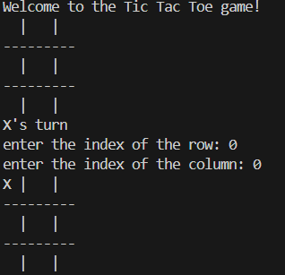

## Tic-Tac-Toe

A console-based Tic-Tac-Toe game written in Python, featuring a player-versus-computer mode. The computer uses rule-based logic to identify winning opportunities and block the player's moves.

## Screenshot

